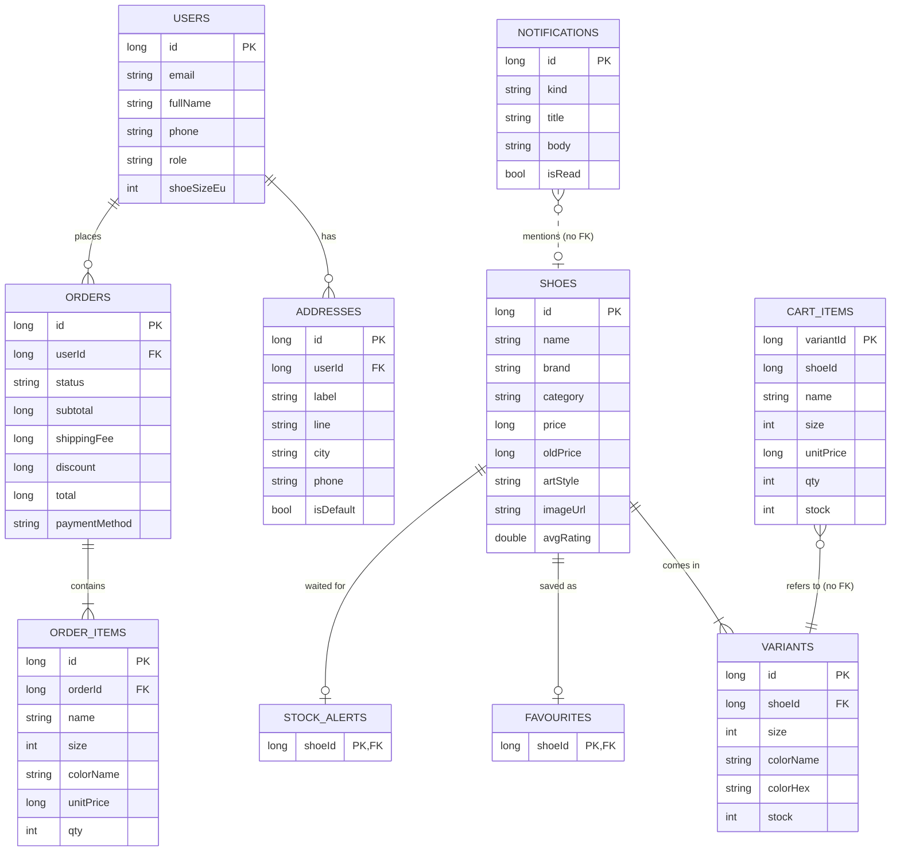

# Architecture of the Shushop Android app

## Layers (MVVM)

```
ui/screens ─► ui/ShopViewModel ─► data/ShopRepository ─┬─► data/*Dao  (Room, SQLite on the phone)
 (Compose)      (state + actions)     (one place for      └─► remote/ApiClient  (the Shushop server)
                                       every decision)
```

- **Screens** only draw state and call ViewModel functions. They hold no business rules.
- **ShopViewModel** exposes `StateFlow`s (shop list, cart, price, orders, notifications, messages) and wraps every action in one helper that sets a *busy* flag and turns errors into a message for the user.
- **ShopRepository** decides what happens: ask the server, then save the answer in Room. Its functions are `suspend`; the DAOs return `Flow` for everything a screen shows, so the screens update by themselves when the data changes.
- **Room** is a copy of the server's data for this user. It is rebuilt from `GET /api/mobile/sync`. `AppDatabase` is a singleton (`AppDatabase.get(context)`); because the data is only a copy, a schema change simply recreates it.

## Room database

Ten entities, six foreign-key relations (`ON DELETE CASCADE`), plus two relation classes (`@Embedded` + `@Relation`).



Why `CART_ITEMS` and `NOTIFICATIONS` have no foreign key: a cart line carries a copy of the shoe's name, price and stock (the server decides if it is still valid), and a notification may mention a shoe that was removed later. A foreign key would delete or reject such rows.

### DAOs

| DAO | Reads (`Flow`) | Writes (`suspend`) |
| --- | --- | --- |
| `ShoeDao` | all shoes with variants, one shoe, favourite ids, alert ids | set / clear favourite and alert |
| `CartDao` | cart lines | `replaceWith` (`@Transaction`), `clear` |
| `OrderDao` | all orders with items, one order | `savePlacedOrder` and `saveCancelledOrder` (`@Transaction`: order + items + cart + stock together) |
| `AccountDao` | the user, addresses | `replaceAddresses` (`@Transaction`) |
| `NotificationDao` | notifications | mark one / all as read |
| `SyncDao` | - | `replaceAll(snapshot)`: wipes and refills every table in one `@Transaction`, in an order that respects the foreign keys |

## Talking to the server

`ApiClient` uses `HttpURLConnection` and `org.json` (both already in Android), so there is no extra library. Every call carries `Authorization: Bearer <token>`. Errors become `ApiException(status, message)` (the server's readable text) or `NetworkException` (no connection). A `401` makes the repository forget the session, which flips `loggedIn` to false and brings back the login screen. `PATCH` is sent as `POST` plus `X-HTTP-Method-Override: PATCH`, which the server understands.

The token is stored in `SharedPreferences` **encrypted** with an AES-GCM key kept in the Android Keystore (`TokenCipher`).

## Navigation

`AppRoot` hosts a `NavHost`. Four tabs live in a floating black pill bar (Home = shop, Notifications, Wishlist, Profile); detail, cart, orders, order detail and addresses open on top of them. When the user logs in or out the whole navigation graph is recreated, so nobody lands on the previous user's screen.

| Route | Screen |
| --- | --- |
| `shop` · `notifications` · `wishlist` · `profile` | the four tabs |
| `detail/{id}` | shoe detail |
| `cart` | cart and checkout |
| `orders` · `order/{id}` | history and one order |
| `addresses` | saved addresses |
| (before login) | login and register |

## Course checklist (BusinessProgramming 3-week Android guide)

| Requirement | Where it is |
| --- | --- |
| At least 6 screens | login/register, shop, detail, cart/checkout, orders, order detail, notifications, wishlist, profile, addresses |
| At least 4 Room entities with 2 relations | 10 entities, 6 foreign keys, `ShoeWithVariants` and `OrderWithItems` (`@Relation`) |
| Register + login with validation, session restore, logout | `AuthScreens.kt`, `Validators.kt`, `SessionStore` + `TokenCipher`, logout in the profile |
| List with search and filter | `ShopScreen.kt`, `ShoeFilter` (search, category chips, size, brand, sort) |
| Detail screen | `DetailScreen.kt` |
| Cart / booking saved with `@Transaction` | `OrderDao.savePlacedOrder`, `CartDao.replaceWith`, `SyncDao.replaceAll` |
| Order history | `OrdersScreen.kt` |
| DAOs with `Flow` + `suspend`, singleton database | `Daos.kt`, `AppDatabase.get()` |
| MVVM | `ShopViewModel`, `ShopRepository`, screens without logic |
| At least 4 unit tests | 85 tests in `app/src/test` |
| Signed APK | see "Build a signed APK" in the README |
| Bonus: real backend | Node + PostgreSQL on Supabase, shared with the website |
| Bonus: real photos | owner photo URL shown when set (`RemoteImage`), drawn shoe otherwise |
| Bonus: notifications | in-app notification centre fed by the server (price drops, restocks, order updates) |

Not done: translation of the interface (English only) and system push notifications (the notification centre is filled when the app refreshes).
